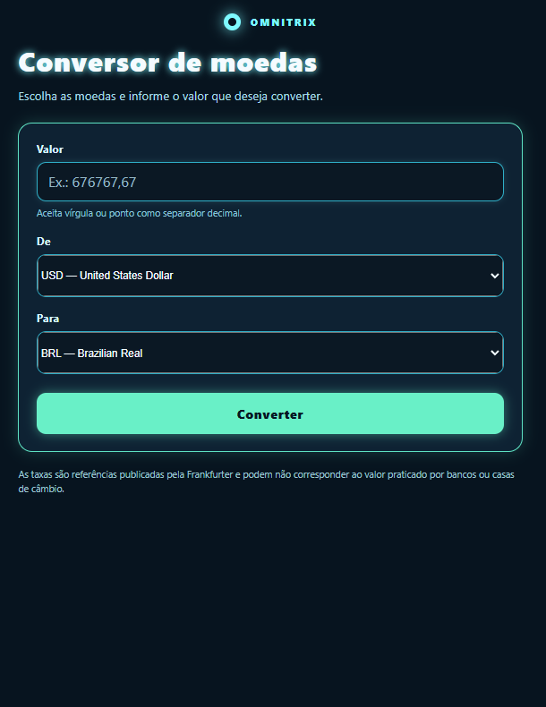
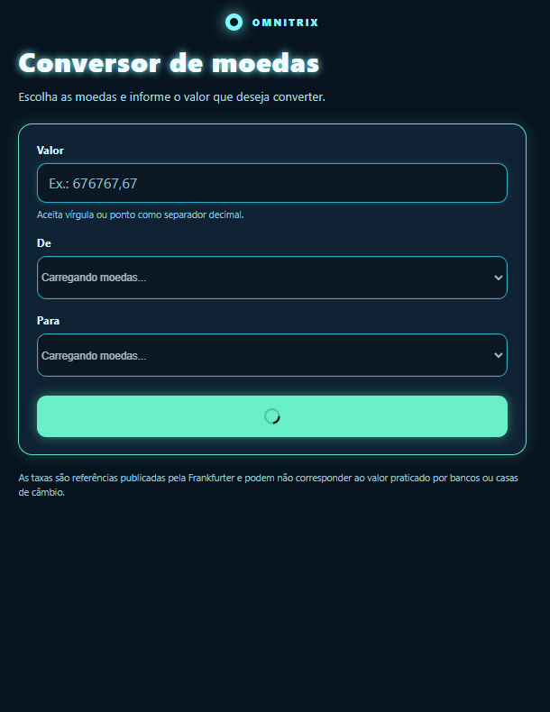
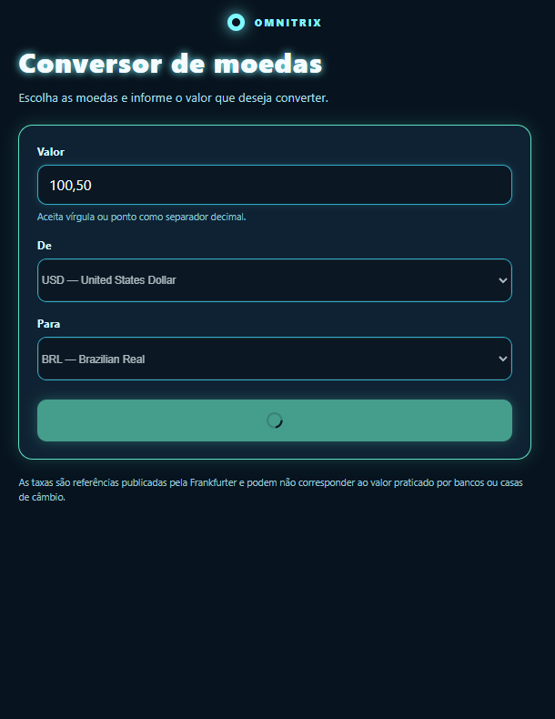
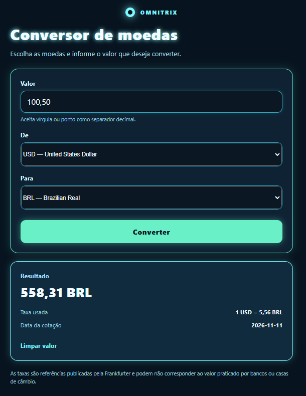
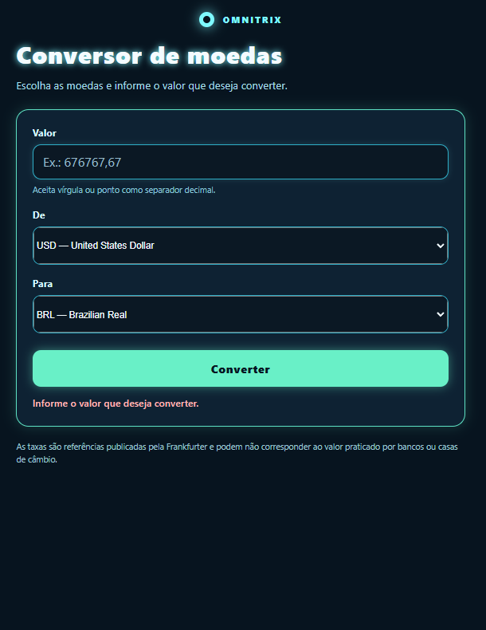
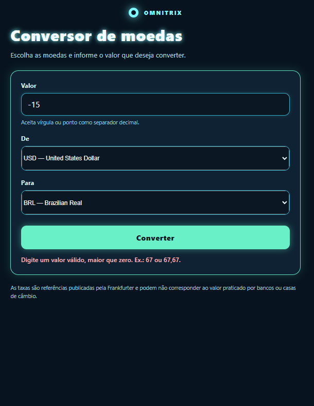
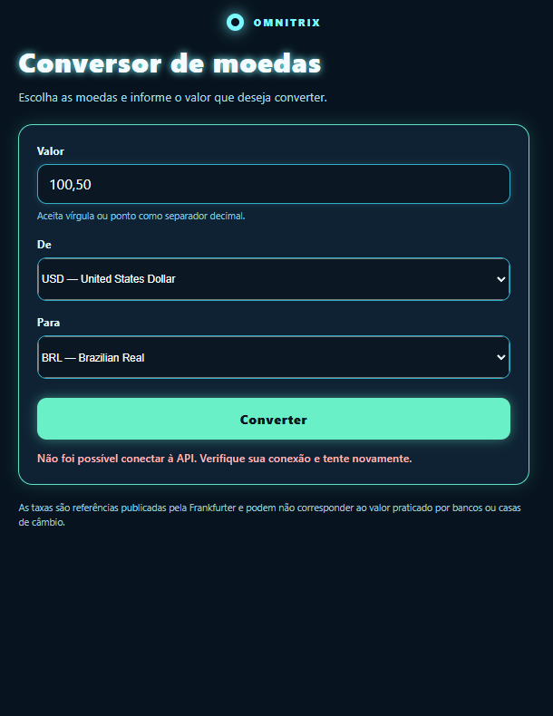
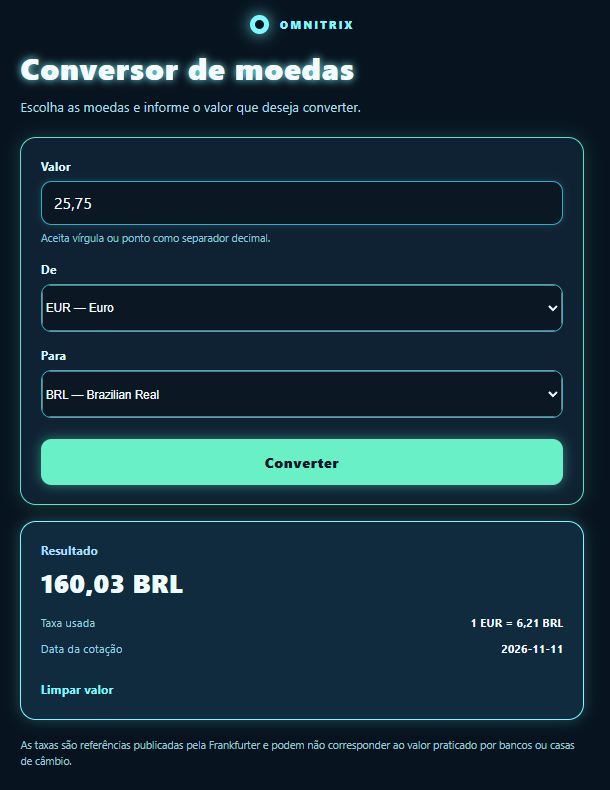
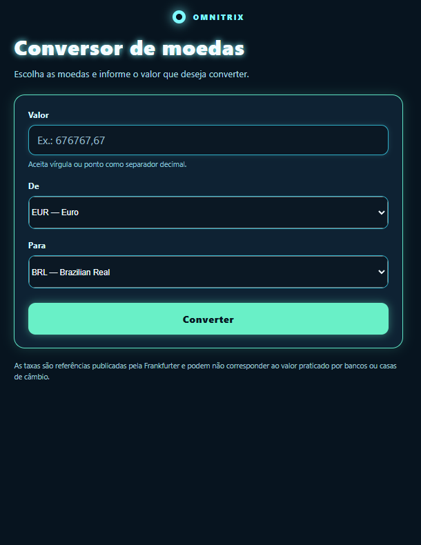

# Conversor de moedas

Aplicativo em React Native e Expo para consultar a conversão entre moedas. As cotações vêm da API pública Frankfurter.

## Capturas dos cenários

As imagens mostram as principais telas e respostas do aplicativo.

### Abertura e conversão

| Tela inicial | Carregando as moedas |
| --- | --- |
|  |  |

| Consultando a cotação | Conversão concluída |
| --- | --- |
|  |  |

### Validação dos dados

| Campo vazio | Valor igual a zero |
| --- | --- |
|  |  |

| Valor negativo | Moedas iguais |
| --- | --- |
|  |  |

### Falha e novas tentativas

| Falha de conexão | Nova conversão |
| --- | --- |
|  |  |

| Valor limpo |
| --- |
|  |

## Como executar

Instale o [Node.js](https://nodejs.org/) e, na pasta do projeto, rode:

```bash
npm install
npx expo start
```

Para abrir no navegador:

```bash
npx expo start --web
```

## Sobre as conversões

- A lista de moedas é carregada da API Frankfurter.
- O valor precisa ser maior que zero; números decimais podem ser escritos com vírgula ou ponto.
- A origem e o destino devem ser moedas diferentes.
- O resultado mostra o valor convertido, a taxa usada e a data da cotação.
- Se a consulta falhar, confira a conexão e tente novamente.

As taxas são referências e podem ser diferentes das usadas por bancos e casas de câmbio.

## Organização do código

- `src/models/currencyModel.js` consulta a API e prepara os dados.
- `src/viewmodels/useConverterViewModel.js` valida os valores e controla a conversão.
- `src/views/HomeView.js` contém a tela do aplicativo.
- `App.js` conecta a tela à lógica de conversão.
